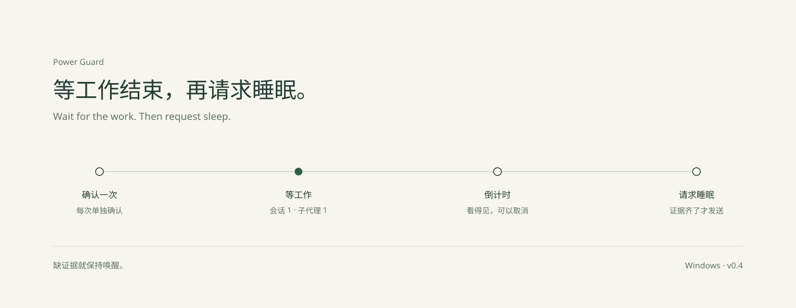
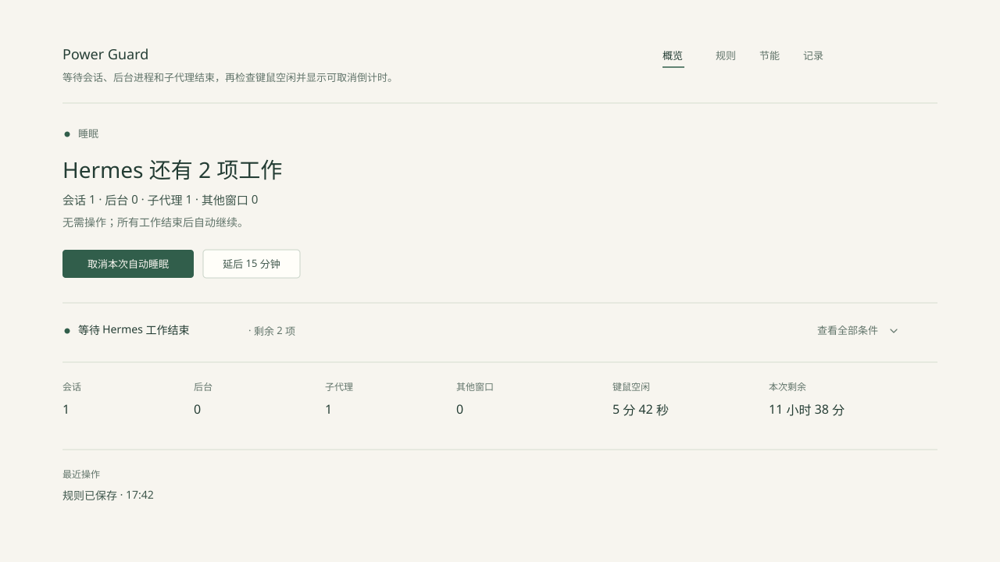

# Hermes Power Guard



Hermes Power Guard puts Windows to sleep after Hermes has no observable work left. A chat reply that says the work is done is not enough.

Each use needs one confirmation. If the focused Desktop project is already running, Power Guard follows that work immediately; otherwise it waits for the next task. It tells you what is still keeping the PC awake, and shows a countdown you can cancel before it asks Windows to sleep.

[Download latest](https://github.com/Yueyue673/hermes-power-guard/releases/latest) · [Install](#install) · [How it decides](#how-it-decides) · [Troubleshooting](docs/TROUBLESHOOTING.md) · [中文](README.zh-CN.md)



## Install

Windows PowerShell:

```powershell
git clone https://github.com/Yueyue673/hermes-power-guard.git "$env:LOCALAPPDATA\hermes\plugins\power-guard"
hermes plugins enable power-guard --no-allow-tool-override
```

Restart Hermes Desktop once. In **Settings → Plugins**, enable **Power Guard**. The Python plugin and the Desktop UI have separate switches; both must be on. Installation never turns on automatic sleep.

Already cloned elsewhere? Run `python scripts/install.py`.

## Use

Open **Power Guard** from the Desktop sidebar.

- **Overview** shows the current conclusion, the evidence, the next event, and one primary action.
- **Rules** controls what counts as finished and how long confirmation takes.
- **Energy** controls the display, priority, and power plan while Hermes is still working.
- **History** shows task results and state changes.

Save the rule, then select **Enable this automatic sleep**. A running focused session is captured immediately. If the page has lost chat focus, the current scope is restored from Desktop's list of busy sessions. Unrelated old daemons are not counted as this campaign's work.

Inspection and simulation commands:

```text
/power-guard status
/power-guard cancel
/power-guard snooze 15
/power-guard resume
/power-guard test 8
```

## How it decides

### It waits for work, not wording

A final chat reply is not enough. Active Hermes sessions, background terminals, pending completion deliveries, subagents, running cron jobs, other busy Desktop windows, and protected applications can all keep the PC awake.

By default, long-running terminal processes that were already active when you confirmed are treated as the campaign baseline. Processes started afterwards still have to finish. Cron runs, subagents, and pending completion deliveries always block, because their stable IDs cannot prove that a later occurrence is the same pre-confirmation work. A stricter “wait for all Hermes background processes” policy is still available.

### It stays awake when evidence is missing

If a required sensor, task result, input idle time, or Desktop connection cannot be read, Power Guard does not continue toward sleep. A restart also cancels the current one-shot rule.

### It cancels when you return

Keyboard or mouse input during the countdown cancels it. New Hermes work, a rule change, an offline control panel, or a clock or resume gap also restarts the checks.

## The path to sleep

```text
Confirm this one use
  → observe a new Hermes task
  → wait for every tracked item to finish
  → check Desktop, input, and protected applications
  → watch briefly for late work
  → show a cancelable countdown
  → check tasks and input one last time
  → ask Windows to sleep once
```

The sleep request is not forced. Windows or an application may reject it to protect unsaved work. Power Guard reports the rejection and does not retry automatically.

## Compatibility and boundary

| | Boundary |
|---|---|
| Real power actions | Windows; local Hermes Desktop-managed backend |
| Default action | Non-forced sleep |
| Work that can finish the rule | The current project already captured when you enable it, plus work observed after confirmation |
| Work that can block it | Connected Desktop sessions, background processes, subagents, running cron jobs, protected applications, unknown sensors |
| Automated tests | Simulation only; no real power action |
| Interface language | Chinese in v0.4; English documentation included |

A separate remote backend or detached profile that is not connected to the current Desktop cannot be proven idle. Power Guard does not claim to cover it.

## Project documents

- [Product design](DESIGN.md)
- [Benchmarks](docs/BENCHMARKS.md)
- [State matrix](docs/STATE-MATRIX.md)
- [Product language](docs/PRODUCT-LANGUAGE.md)
- [Architecture](docs/ARCHITECTURE.md)
- [Threat model](docs/THREAT-MODEL.md)
- [Troubleshooting](docs/TROUBLESHOOTING.md)
- [Compatibility](docs/COMPATIBILITY.md)
- [Security policy](SECURITY.md)
- [Contributing](CONTRIBUTING.md)
- [Changelog](CHANGELOG.md)

MIT — see [LICENSE](LICENSE).
