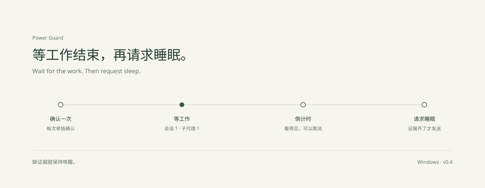
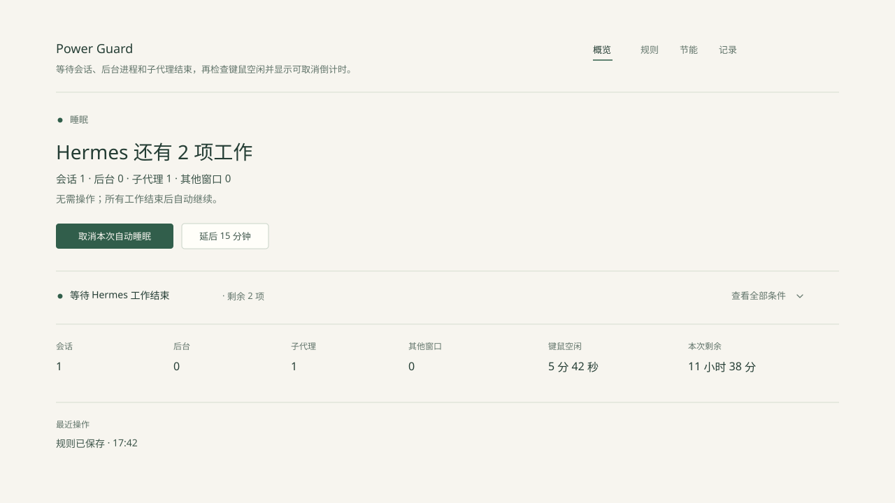

# Hermes Power Guard



Hermes Power Guard 用来在 Hermes 这边确实没有还能看见的工作之后，再让 Windows 进入睡眠。助手在聊天里说「做完了」，本身不算数。

每次用都要确认一次。如果当前聚焦的 Desktop 项目已经在跑，它会马上跟住这次任务；否则就等下一个任务。它会说明电脑为什么还没睡，并在向 Windows 发出睡眠请求前给出一段可以取消的倒计时。

[下载最新版](https://github.com/Yueyue673/hermes-power-guard/releases/latest) · [安装](#安装) · [它怎么判断](#它怎么判断) · [排障](docs/TROUBLESHOOTING.md) · [English](README.md)



## 安装

Windows PowerShell：

```powershell
git clone https://github.com/Yueyue673/hermes-power-guard.git "$env:LOCALAPPDATA\hermes\plugins\power-guard"
hermes plugins enable power-guard --no-allow-tool-override
```

重启一次 Hermes Desktop，然后在 **设置 → 插件** 中启用 **Power Guard**。Python 插件和 Desktop 界面是两个独立开关，必须同时打开。安装本身不会打开自动睡眠。

已经克隆到其他目录？运行 `python scripts/install.py`。

## 使用

从 Desktop 侧栏打开 **Power Guard**。

- **概览**：当前结论、依据、下一件事，以及这一个主要操作。
- **规则**：什么算结束，以及确认需要多久。
- **节能**：Hermes 还在工作时，显示器、优先级和电源计划怎么处理。
- **记录**：任务结果和状态变化。

保存规则后，点击 **启用本次自动睡眠**。当前聚焦的会话如果已经在跑，会被马上跟住；页面丢失聊天焦点时，会从 Desktop 的忙碌会话列表里恢复当前范围。无关的旧后台进程，不会被算成这一次的任务。

检查和模拟可以用这些命令：

```text
/power-guard status
/power-guard cancel
/power-guard snooze 15
/power-guard resume
/power-guard test 8
```

## 它怎么判断

### 等的是工作，不是那句话

聊天里出现最终回复还不够。活动会话、后台终端、还没送回来的结果、子代理、正在运行的 Cron、其他忙碌窗口和受保护程序，都可以让电脑继续醒着。

默认情况下，你确认时已经在跑的长期终端进程会记成这次的基线；确认之后新启动的进程，仍然必须结束。Cron、子代理和还没送回来的结果，不管何时开始都会继续挡住睡眠，因为稳定 ID 无法证明后来出现的就是确认前的同一轮工作。需要时仍可改成「等待所有 Hermes 后台进程」这条更严的规则。

### 读不到依据时，先不睡

必要的传感器、任务结果、键鼠空闲时间或 Desktop 连接读不到时，Power Guard 不会继续往睡眠靠近。重启也会取消这一次的规则。

### 你回来时会取消

倒计时期间出现键鼠输入，会马上取消。新的 Hermes 任务、规则变化、控制面板离线、时钟跳变或系统恢复，也会重新开始检查。

## 到睡眠之前会走完这些步

```text
确认本次自动睡眠
  → 接管当前运行中的项目；若没有则等待下一个任务
  → 等所有被跟踪的工作结束
  → 检查 Desktop、键鼠和受保护程序
  → 继续观察一小段时间，等待迟到任务
  → 显示可取消倒计时
  → 最后再检查一次任务和键鼠
  → 向 Windows 请求一次睡眠
```

睡眠请求不使用强制模式。Windows 或应用可以为了保护未保存的工作而拒绝。Power Guard 会显示这次失败，并且不会自动再试。

## 能用在哪，边界在哪

| | 边界 |
|---|---|
| 真实电源动作 | Windows；本机 Hermes Desktop 管理的后端 |
| 默认动作 | 非强制睡眠 |
| 可以完成本次规则的工作 | 启用时已接管的当前项目，以及确认后观察到的任务 |
| 可以阻止执行的工作 | 当前 Desktop 会话、后台进程、子代理、运行中的 Cron、受保护程序、未知传感器 |
| 自动测试 | 只模拟，不执行真实电源动作 |
| 界面语言 | v0.4 为中文；仓库同时提供英文文档 |

完全独立、没有连到当前 Desktop 的远程 backend 或 profile，无法被证明空闲；Power Guard 不会说自己也管得到那里。

## 项目文档

- [产品设计](DESIGN.md)
- [成熟项目对标](docs/BENCHMARKS.md)
- [状态矩阵](docs/STATE-MATRIX.md)
- [产品语言](docs/PRODUCT-LANGUAGE.md)
- [架构](docs/ARCHITECTURE.md)
- [威胁模型](docs/THREAT-MODEL.md)
- [排障](docs/TROUBLESHOOTING.md)
- [兼容性](docs/COMPATIBILITY.md)
- [安全报告](SECURITY.md)
- [参与贡献](CONTRIBUTING.md)
- [更新记录](CHANGELOG.md)

MIT，见 [LICENSE](LICENSE)。
